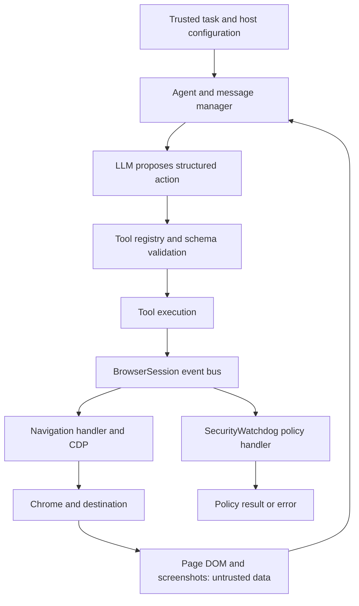
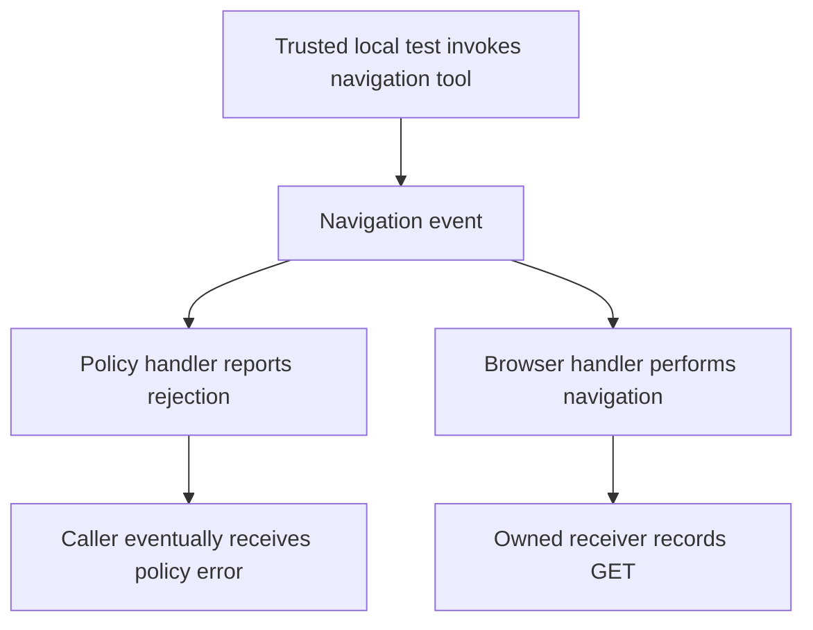

# Architecture and flows

This describes the pinned open-source/local path, not Browser Use Cloud. Arrows show component communication, not an automatic grant of authority.

## 1. Normal agent loop



Schema validation answers whether an action has valid fields; it does not prove that its side effect is authorized. A policy-handler error is not automatically a transaction-wide cancellation.

## 2. Recorded navigation failure



Observed: error **and** received request. The source supports separate handlers; this is not a precise measured ordering diagram. No LLM or malicious-page chain was part of this case.

## 3. Separate answer and authorization checks

```text
Owned page text → browser state → restricted model → done
                                      ↓
                       compare exact answer with known value

Synthetic principal → MCP client → STDIO MCP server
                                   ↓
                         application authorization
                                   ↓
                         instrumented data accessor
```

The answer checks exposed an extra label, not task replacement. The auth checks belong to the owned application fixture, not an automatic Browser Use permission system.

## 4. Assessment workflow

```text
Pin source → identify boundary and expected invariant
           → positive and negative controls
           → compare tool/model output with receiver/accessor records
           → inspect alternative explanations
           → classify defect, rejected hypothesis or remaining gap
```

Sources: browser_use/agent/service.py, tools/service.py, browser/session.py, browser/watchdogs/security_watchdog.py; exact provenance in [source-pins.json](evidence/source-pins.json). Diagrams simplify components and do not claim exhaustive coverage.
