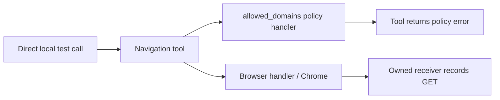

# Browser Use: rejected navigation still sent a request

**Status:** behavior defect reproduced; exploitable SSRF not established.

Browser Use operates Chrome through tools. In a local check, the navigation tool rejected an excluded destination, but the owned HTTP server still recorded its GET request.

- **Expected:** reject the navigation before contacting the destination.
- **Observed:** policy error and network request both occurred.
- **Impact:** a tool error did not prove prevention of the network side effect.
- **Limit:** trusted test code called the tool directly; no malicious-page → LLM → protected-resource chain was demonstrated.
- **Fix:** no upstream fix was verified.

Three other failed assertions were answer-format failures, not confirmed prompt injection.

## Where to start

| Open | What you will find |
| --- | --- |
| [Flow](#flow) | Compare the navigation policy error with the observed network side effect. |
| [Matrix catalog](#json-matrices) | Find the navigation, model output, app authorization and proxy checks. |
| [Recorded outcomes](evidence/failures.json) · [Coverage](evidence/coverage.json) | Separate the navigation observation from the formatting failures. |
| [GitHub Actions](#github-actions) | Run the offline tests on the shipped records and synthetic traces. |

## Boundaries, tests and evidence

Open the [boundary index](matrices/boundaries.json), then [recorded navigation and format outcomes](evidence/failures.json) and [coverage](evidence/coverage.json). [Python tests](tests/test_recorded_evidence.py) check the saved records and exercise the [trace oracle](tests/trace_oracle.py) with synthetic input. The public revision contains these offline checks and selected historical records.

Run the offline evidence checks from the repository root with Python 3.10 or later.

```sh
python -B -m unittest discover -s tests -v
```

## GitHub Actions

Open [Case study checks](https://github.com/Keedz1Off/browser-use-agent-security-case-study/actions/workflows/checks.yml) and click **Run workflow**. CI reads the matrix JSON and checks the saved evidence offline. The run saves a `check-results` log. Select **CD demo** to also download `verified-delivery` with the log, commit SHA and checksum after checks pass.

### What happens in Actions

| Step | What it does |
| --- | --- |
| Checkout and Python | GitHub runs the selected commit on Ubuntu with Python 3.12. |
| Matrix JSON | CI requires the boundary index and reads every JSON file in the matrices folder. |
| Evidence tests | Four tests check the saved navigation, formatting and coverage records and validate the trace oracle with synthetic inputs. |
| Check log | CI uploads the result as `check-results`. |
| CD demo | After a passing manual run, CI saves the log, commit SHA and SHA-256 checksum as `verified-delivery`. |

[See the workflow file](.github/workflows/checks.yml). This job checks the material shipped in this repository offline.

## Flow



Logical paths only; the test did not trace handler execution order.

## JSON matrices

| Boundary checked | JSON matrix |
| --- | --- |
| Navigation policy | [NAVIGATION](matrices/NAVIGATION.json) |
| Restricted model output | [MODEL-OUTPUT](matrices/MODEL-OUTPUT.json) |
| Owned application authorization | [MCP-AUTH](matrices/MCP-AUTH.json) |
| Separate Chrome proxy controls | [PROXY](matrices/PROXY.json) |

## How to read

Read the summary and flow, then choose a JSON matrix above. Expand **Technical details** for field guidance, supporting records and exact versions.

<details>
<summary>Technical details: reading guide and evidence</summary>

1. Start with the expected/observed summary and flow above.
2. Open [NAVIGATION](matrices/NAVIGATION.json), row `BU-NAV`. Compare `invariant` (required rule), `scenario` (test input), `oracle` (measurement) and `observed` (result).
3. Follow `evidence[].url` to the supporting record; `pointer`, when present, selects a nested JSON entry. Read `status` together with `limits` before judging impact. The other matrices cover separate controls.

[Evidence archive: detailed report and recorded results](https://github.com/Keedz1Off/browser-use-agent-security-case-study/tree/9ce70f92118289996a3c394f27928ffd60da2c16) are preserved in the pinned evidence snapshot. Matrix links open the exact supporting records.

Browser Use 0.13.13, aa093a8; selected local controls. Independent, AI-assisted work. [File inventory](package-manifest.json).

</details>
