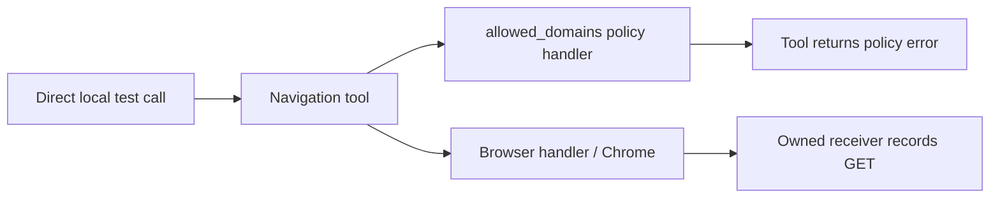

# Browser Use: rejected navigation still sent a request

**Status:** behavior defect reproduced; exploitable SSRF not established.

Browser Use operates Chrome through tools. In a local check, the navigation tool rejected an excluded destination, but the owned HTTP server still recorded its GET request.

- **Expected:** reject the navigation before contacting the destination.
- **Observed:** policy error and network request both occurred.
- **Impact:** a tool error did not prove prevention of the network side effect.
- **Limit:** trusted test code called the tool directly; no malicious-page → LLM → protected-resource chain was demonstrated.
- **Fix:** no upstream fix was verified.

Three other failed assertions were answer-format failures, not confirmed prompt injection.

## Flow

Logical paths only; the test did not trace handler execution order.

## How to read

The summary and flow above explain the main result. Expand **Technical details** to inspect test cases, supporting records and exact versions.

Technical details: matrices and evidence

1. Start with the expected/observed summary and flow above.
2. Open [NAVIGATION](matrices/NAVIGATION.json), row `BU-NAV`. Compare `invariant` (required rule), `scenario` (test input), `oracle` (measurement) and `observed` (result).
3. Follow `evidence[].url` to the supporting record; `pointer`, when present, selects a nested JSON entry. Read `status` together with `limits` before judging impact. The other matrices cover separate controls.

### Matrices

| Boundary | JSON |
| --- | --- |
| Navigation policy | [NAVIGATION](matrices/NAVIGATION.json) |
| Restricted model output | [MODEL-OUTPUT](matrices/MODEL-OUTPUT.json) |
| Owned application authorization | [MCP-AUTH](matrices/MCP-AUTH.json) |
| Separate Chrome proxy controls | [PROXY](matrices/PROXY.json) |

[Evidence archive: detailed report, tests, logs and source pins](https://github.com/Keedz1Off/browser-use-agent-security-case-study/tree/9ce70f92118289996a3c394f27928ffd60da2c16) are preserved in the pinned evidence snapshot. Matrix links open the exact supporting records.

Browser Use 0.13.13, aa093a8; selected local controls. Independent, AI-assisted work. Documentation reorganisation only; no new target tests. [File inventory](package-manifest.json).

